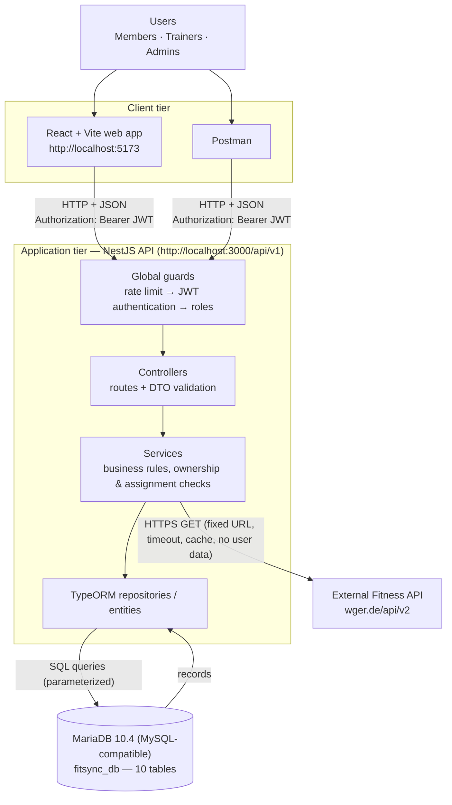
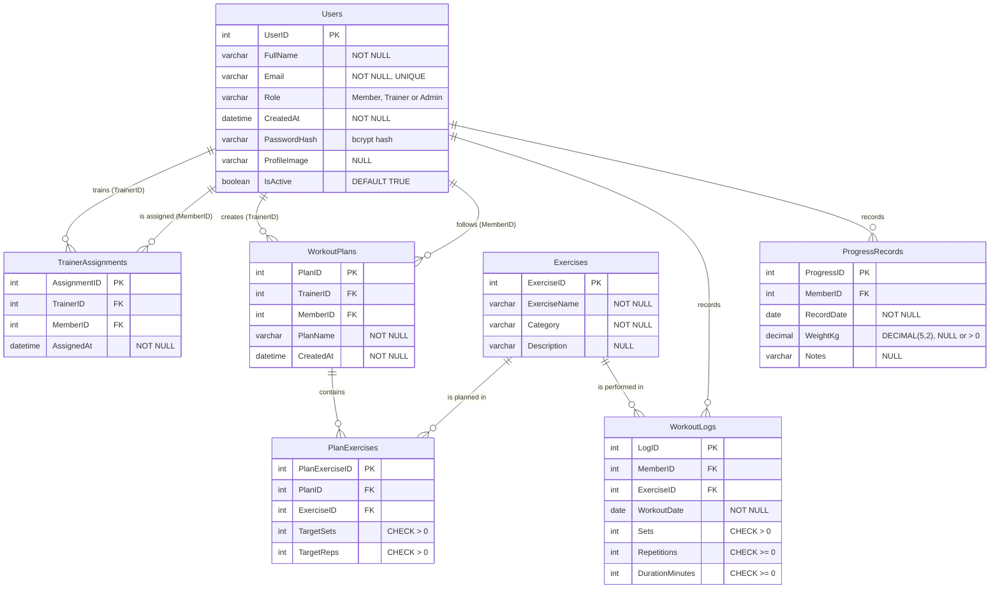

# FitSync — Fitness Activity Monitoring and Management System

FitSync is a web-based information system that helps fitness **members**, **trainers** and **administrators** record, organize and monitor workout activity in one place. It consists of a NestJS REST API, a MySQL-compatible database, a React web application, and an integration with the public **wger** exercise database (the External Fitness API from Laboratory Activity 03).

> **ITEC 116 — Systems Integration and Architecture 2 · Final Project**
> The implementation follows the designs from Laboratory Activities 03 (System Architecture), 04 (Database Design), 05 (REST API Design) and 06 (Authentication and Security Design).

> **Version 2.0 — Fitness management.** Adds workout plan completion tracking, fitness goals and trainer feedback as **enhancements** to the laboratory designs: three new normalized tables (migration 002), 15 new endpoints (70 in total) and new member, trainer and admin screens. The original seven tables, the original 55 endpoints, their responses and all Version 1 behaviour are preserved. See [Version 2.0 features](#version-20--fitness-management), [Version 2.0 tables](#version-20-tables-migration-002) and [docs/DESIGN_DECISIONS.md](docs/DESIGN_DECISIONS.md#version-20--fitness-management).

---

## Table of Contents

1. [Project Overview](#1-project-overview)
2. [System Features](#2-system-features)
3. [Technology Stack](#3-technology-stack)
4. [System Architecture](#4-system-architecture)
5. [Database Design](#5-database-design)
6. [Installation and Setup Tutorial](#6-installation-and-setup-tutorial)
7. [How to Use FitSync](#7-how-to-use-fitsync)
8. [REST API Documentation](#8-rest-api-documentation)
9. [Postman Testing Tutorial](#9-postman-testing-tutorial)
10. [Project Folder Structure](#10-project-folder-structure)
11. [Testing Results](#11-testing-results)
12. [Troubleshooting](#12-troubleshooting)
13. [Limitations and Future Improvements](#13-limitations-and-future-improvements)
14. [Developer Information](#14-developer-information)

---

## 1. Project Overview

### Description

Many people record their workouts on paper or across different apps, which makes it hard to review progress over time. Trainers who coach several members face the same problem. FitSync gives everyone one shared, secure place to work:

- **Members** log workouts and body-weight progress and follow plans made by their trainers.
- **Trainers** build workout plans and monitor the members assigned to them.
- **Administrators** manage accounts, the exercise catalog and trainer–member assignments.

### Purpose

To provide a centralized system for recording and monitoring fitness activities, replacing scattered manual records with structured data that members, trainers and administrators can access according to their role.

### Objectives

- Store users, exercises, workout plans, workout logs and progress records in a normalized relational database.
- Expose the data through a secure, versioned REST API (`/api/v1`).
- Protect every route with JWT authentication, role-based authorization and record ownership checks.
- Give each role a dashboard and downloadable fitness reports computed from real data.
- Enrich the exercise catalog with an external fitness API (wger), with licence attribution.
- Document and test the API so it can be verified with Postman.

### Intended users

| Role | Who they are | What they do |
|---|---|---|
| **Member** | A person who trains | Records workouts and progress, follows assigned plans |
| **Trainer** | A fitness coach | Creates plans and monitors assigned members |
| **Admin** | A system administrator | Manages accounts, exercises and assignments |

---

## 2. System Features

### Member features
- Create an account (public registration always creates a Member account)
- Personal dashboard: workouts and minutes this week, current streak, latest weight and change, 14-day activity chart, weight trend, workouts by category, assigned trainers
- Browse and search the exercise catalog by name and category
- Record, view, filter, edit and delete workout logs (exercise, date, sets, repetitions, duration)
- View workout plans created by trainers, and log a plan exercise with one click
- Record, edit and delete progress records (weight in kg and notes), with a weight trend chart
- **Exercise Library:** browse and search the public wger exercise database (instructions, muscles, equipment, licensed images)
- **Fitness report** for the last 7 days, 30 days or a custom range: totals, consistency, streak, exercise and category breakdown, weight change; download as a formatted **PDF**, a formatted **Excel** workbook or raw **CSV**
- Update profile details, change password, or deactivate the account

### Trainer features
- Trainer dashboard: assigned members, active members this week, member workouts per day, recent member activity
- View assigned members with their recent activity and latest weight
- Create, rename/reassign and delete workout plans for **assigned members only** (a plan can move to another member only while no workout has been counted toward it)
- Add exercises to a plan with target sets and reps, edit targets, and remove exercises
- View the workout history and progress of assigned members (read-only)
- **Member reports:** compare all assigned members, or open one member's full report; PDF, Excel and CSV export
- Browse the external Exercise Library

### Administrator features
- Admin dashboard: user counts by role and status, total workout logs and exercises, top exercises, exercises by category, registrations per month, members without a trainer
- User management: search and filter users, create Member/Trainer/Admin accounts, edit details, change roles, deactivate and re-activate accounts
- Exercise catalog management: add, edit and delete exercises (exercises already used in logs or plans are protected)
- Trainer assignment management: assign, reassign and remove trainer–member links
- **External exercise import:** import selected wger exercises into the local catalog (duplicates refused, licence attribution kept)
- **System report:** users by role and status, registrations, workout activity, top exercises, trainer coverage and system usage; PDF, Excel and CSV export

### Version 2.0 — Fitness management

**Workout plan completion tracking**
- Members log a workout **directly from an assigned plan** (one form, prefilled with the prescription) or count a workout they logged earlier. Actual sets, repetitions and duration are recorded once, in the workout log.
- Each prescribed exercise shows **completed**, **partial** or **pending** for the last 7 or 30 days, with the best actual workout next to the prescription, the plan **completion percentage** and the **completion history**.
- Trainers see completion rates for assigned members, prescribed vs actual per exercise, pending exercises and a per-member adherence view.
- A workout counts toward **one** prescription only; several workouts for the same exercise count once; unrelated exercises never count. Editing or deleting a workout recalculates completion. History survives plan edits and deletion. Completion counts only the plan member's own workouts, and a plan with completion history cannot be moved to another member.

**Fitness goals**
- Members create **target weight** (loss or gain), **weekly workout days** and **weekly training minutes** goals, then update or cancel them. Progress, deadlines and status (active, completed, missed, cancelled) are calculated from the workouts and weight records they already log — nothing is entered twice. An achieved goal is never erased: if its records are later edited or deleted it stays Completed with a note, and a missed goal becomes Completed if late-logged records inside its period reach the target.
- Trainers monitor the goals of assigned members; administrators see aggregate goal statistics only.
- FitSync measures the goals members set; it never suggests targets or gives medical advice.

**Trainer feedback**
- Trainers send short notes (General, Encouragement, Guidance, Concern) to assigned members, optionally about a goal or a workout plan, and can edit or delete their own notes.
- Members see new and read feedback, mark it as read, and get an unread badge in the navigation. It is not a chat.
- Feedback history is kept when a member changes trainer: the former trainer can still read the notes they wrote but loses access to the member's workouts, plans and completion data. Administrators see counts only, never message content.

**Dashboards and reports** gain completion, goal and feedback sections; PDF, Excel and CSV exports include them (feedback as counts only).

### Authentication and security
- Email and password login that returns a **JWT** (expires after `JWT_EXPIRES_IN`, default 1 hour)
- Passwords hashed with **bcrypt**; password hashes are never returned by the API
- **Secure by default**: every endpoint requires a token except health check, login and registration
- **Role-based access control** (403 for the wrong role) plus **record ownership** and **trainer-assignment** checks
- Deactivated accounts are rejected at login *and* on every request, even with an unexpired token
- **Input validation** on every request body and query string (400 with clear messages)
- **Login rate limiting** (default 5 attempts per minute per IP, then 429)
- CORS limited to the frontend origin; all secrets kept in environment variables
- External API calls go only to a fixed, trusted address, never send user data, time out, are cached, and fail gracefully (502/503/504) instead of inventing data
- CSV exports are protected against spreadsheet formula injection

---

## 3. Technology Stack

| Layer | Technology | Purpose |
|---|---|---|
| Backend framework | **NestJS 11** (Node.js) with **TypeScript** | Modular REST API: controllers, services, modules |
| ORM | **TypeORM 0.3** | Maps TypeScript entities to database tables |
| Database | **MySQL-compatible MariaDB 10.4** (XAMPP) | Relational data storage |
| Authentication | **JWT** (`@nestjs/jwt`), **bcrypt** | Token-based login, password hashing |
| Validation | **class-validator**, **class-transformer** | Request validation and response serialization |
| Rate limiting | `@nestjs/throttler` | Brute-force protection on login |
| Frontend | **React 19** + **Vite 7** + TypeScript | Single-page web application |
| Styling | **Tailwind CSS 4** | Dark charcoal / lime-green design system |
| Frontend libraries | React Router 7, Axios, Recharts, Lucide React | Routing, HTTP client, charts, icons |
| Report exports | **jsPDF 4** + **jspdf-autotable 5**, **ExcelJS 4** | Formatted PDF reports and Excel workbooks, generated in the browser |
| External Fitness API | **wger** public REST API (`https://wger.de/api/v2`) | Exercise information, images and licences |
| API testing | **Postman** (and Newman CLI) | Manual and automated API tests |
| Automated tests | Jest, Supertest | Unit and end-to-end tests |
| Version control | Git and GitHub | Source code history |

---

## 4. System Architecture



### How the parts communicate

1. **Frontend → Backend.** The React app (or Postman) sends HTTP requests with JSON bodies to `http://localhost:3000/api/v1`. After login, the Axios client adds the header `Authorization: Bearer <token>` to every request automatically.
2. **Inside the backend.** Each request passes through the global guards (rate limiter, JWT check, role check), then the `ValidationPipe` checks the body against a DTO. The **controller** passes clean data to the **service**, which applies the business rules and uses a **TypeORM repository**.
3. **Backend → Database.** TypeORM turns repository calls into parameterized SQL and runs them on MariaDB (a MySQL-compatible server). Results come back as entity objects.
4. **Back to the client.** The service returns data to the controller, which sends JSON with the right status code (200, 201 or 204). Any error, from validation to a database constraint, is converted to one standard error format.
5. **External Fitness API.** For the Exercise Library, the backend (never the browser) requests exercise data from wger, normalizes it into the FitSync format, removes HTML, keeps licence attribution and caches it. Admin imports copy an exercise into the local `Exercises` table, so workout logs and plans always reference local records.

> **Layered flow:** Client → Controller → Service → Repository → Database → back to the client.
> A full walk-through with code references is in [docs/ARCHITECTURE.md](docs/ARCHITECTURE.md).

---

## 5. Database Design

The schema is defined in [`database/schema.sql`](database/schema.sql) and follows the Laboratory Activity 04 data dictionary. The database keeps the documented PascalCase column names (e.g. `FullName`), while the API uses camelCase (e.g. `fullName`).

### The seven tables

| Table | Purpose | Key columns and rules |
|---|---|---|
| **Users** | Accounts for all three roles | `UserID` PK · `Email` UNIQUE · `Role` CHECK (Member/Trainer/Admin) · `PasswordHash` (bcrypt) · `IsActive` (soft deactivation) |
| **TrainerAssignments** | Links a trainer to a member they coach | `TrainerID` and `MemberID` FKs to Users · UNIQUE (TrainerID, MemberID) |
| **Exercises** | The exercise catalog | `ExerciseName`, `Category`, optional `Description` |
| **WorkoutPlans** | A plan a trainer creates for a member | `TrainerID` and `MemberID` FKs to Users · `PlanName` |
| **PlanExercises** | Exercises inside a plan, with targets | `PlanID` FK (ON DELETE CASCADE) · `ExerciseID` FK · `TargetSets` > 0 · `TargetReps` > 0 |
| **WorkoutLogs** | Workouts recorded by members | `MemberID`, `ExerciseID` FKs · `WorkoutDate` · `Sets` > 0 · `Repetitions` ≥ 0 · `DurationMinutes` ≥ 0 |
| **ProgressRecords** | Weight and notes recorded by members | `MemberID` FK · `RecordDate` · `WeightKg` DECIMAL(5,2) > 0 or NULL · `Notes` |

**Relationships:**
- Trainers and members are many-to-many, through **TrainerAssignments**.
- Plans and exercises are many-to-many, through **PlanExercises**.
- A member has many workout logs and progress records.

Users are never hard-deleted. Deactivation keeps history and foreign keys valid.

> **Schema extension (migration 001).** To store where imported exercises come from, the `Exercises` table has seven additional **nullable** columns: `ExternalSource`, `ExternalID`, `SourceUrl`, `LicenseName`, `LicenseUrl`, `LicenseAuthor` and `ImportedAt`. A unique constraint on (`ExternalSource`, `ExternalID`) prevents duplicate imports. Local exercises have `NULL` in all of them. The original seven tables and Lab 04 columns are unchanged. See [docs/ERD.md](docs/ERD.md#schema-extension--migration-001-lab-alignment-upgrade).

### Version 2.0 tables (migration 002)

Three normalized tables **extend** the Lab 04 design. Nothing in the original seven tables changes.

| Table | Purpose | Key columns and rules |
|---|---|---|
| **WorkoutCompletions** | Counts one workout log toward one prescribed plan exercise | `LogID` FK (ON DELETE CASCADE) · **UNIQUE (`LogID`)** (no double counting) · `PlanExerciseID`, `PlanID` FKs (ON DELETE SET NULL) · snapshot `PlanNameSnapshot`, `PrescribedSets`, `PrescribedReps` (> 0) |
| **FitnessGoals** | A member's goal; progress is calculated, not stored | `MemberID` FK · `GoalType` CHECK (TargetWeight / WeeklyWorkouts / WeeklyMinutes) · `StartingValue`, `TargetValue` > 0 · `TargetDate` > `StartDate` · `Status` CHECK (Active / Completed / Missed / Cancelled) · `ClosedAt` |
| **TrainerFeedback** | A trainer's note to an assigned member | `TrainerID`, `MemberID` FKs · optional `RelatedGoalID` / `RelatedPlanID` (ON DELETE SET NULL) · `FeedbackType` CHECK · `FeedbackMessage` ≤ 1000 chars · `CreatedAt`, `UpdatedAt`, `ReadAt` |

- A completion's status is **derived** from the linked log (actual sets/reps) versus the copied prescription, so editing the log recalculates it and deleting the log removes it.
- Rules that involve foreign-key columns (the log's owner must be the plan's member, at most one related goal or plan, …) are enforced by the API, because MySQL 8 forbids CHECK constraints on columns with FK actions.
- Existing databases get the tables with `npm run db:migrate` (additive and repeatable). Details: [docs/ERD.md](docs/ERD.md#schema-extension--migration-002-version-20).

### Entity Relationship Diagram



More detail (constraints, column mapping, normalization) is in [docs/ERD.md](docs/ERD.md).

---

## 6. Installation and Setup Tutorial

### 6.1 Prerequisites

| Software | Version used | Notes |
|---|---|---|
| [Node.js](https://nodejs.org/) | 20 or newer (developed on Node 24) | Includes npm |
| [XAMPP](https://www.apachefriends.org/) | Any recent version | Provides MariaDB (shown as "MySQL" in the XAMPP Control Panel) and phpMyAdmin. Developed and tested on MariaDB 10.4, a MySQL-compatible server. MySQL 8 was not independently tested. |
| [Git](https://git-scm.com/) | Any | To clone the repository |
| [Postman](https://www.postman.com/downloads/) | Any | Optional, for API testing |

### 6.2 Clone the repository

```bash
git clone https://github.com/momonim24/FitSync.git
cd FitSync
```

### 6.3 Install dependencies

```bash
cd backend
npm install
cd ../frontend
npm install
cd ..
```

### 6.4 Configure environment variables

The backend reads its settings from `backend/.env`. A template with every variable is provided.

```bash
# macOS / Linux / Git Bash
cp backend/.env.example backend/.env

# Windows PowerShell
Copy-Item backend\.env.example backend\.env
```

Open `backend/.env` and fill in these values:

| Variable | What to enter |
|---|---|
| `DB_HOST`, `DB_PORT` | `localhost` and `3306` (XAMPP defaults) |
| `DB_USERNAME`, `DB_PASSWORD` | Your MySQL login. A fresh XAMPP install uses `root` with an **empty** password. |
| `DB_NAME` | `fitsync_db` |
| `DB_TEST_NAME` | `fitsync_test_db` (used only by the automated tests; it is wiped on every test run) |
| `JWT_SECRET` | A long random string, **at least 32 characters**. Generate one with:<br/>`node -e "console.log(require('crypto').randomBytes(48).toString('hex'))"` |
| `JWT_EXPIRES_IN` | Token lifetime, e.g. `1h` |
| `SEED_ADMIN_PASSWORD`, `SEED_TRAINER_PASSWORD`, `SEED_MEMBER_PASSWORD` | Passwords you choose for the demo accounts (8–72 characters, at least one letter and one number). If you leave them blank, the seed script generates random passwords and prints them **once**. |

The remaining variables (`PORT=3000`, `CORS_ORIGINS=http://localhost:5173`, `BCRYPT_SALT_ROUNDS`, `LOGIN_RATE_LIMIT`, `GLOBAL_RATE_LIMIT`, `WGER_TIMEOUT_MS`, `WGER_CACHE_TTL_SECONDS`) can stay at their template values. The wger address itself is fixed in code and cannot be changed through `.env`.

> **Never commit `backend/.env`.** It is already listed in `.gitignore`. Only the `.env.example` templates, which have blank secrets, belong in the repository.

The frontend works without configuration. To point it at a different API address, copy `frontend/.env.example` to `frontend/.env` and change `VITE_API_URL` (default `http://localhost:3000/api/v1`).

### 6.5 Start XAMPP MySQL

XAMPP's "MySQL" module runs **MariaDB**, a MySQL-compatible server; FitSync was developed and tested on MariaDB 10.4.

1. Open the **XAMPP Control Panel**.
2. Click **Start** next to **MySQL**, and next to **Apache** if you want phpMyAdmin.
3. Confirm MySQL shows port **3306**.

### 6.6 Initialize and seed the database

```bash
cd backend
npm run db:init
npm run db:migrate
npm run db:seed
```

- `npm run db:init` runs `database/schema.sql`. It creates the `fitsync_db` database and the 10 tables (7 from Lab 04 + 3 from Version 2.0) if they don't exist yet, and never drops anything, so it is safe to run again.
- `npm run db:migrate` applies schema migrations (001: external exercise source columns; 002: the three Version 2.0 tables; 003: duration targets for timed exercises). It only **adds** missing columns, constraints and tables and is safe to run any number of times. **If you installed FitSync before the upgrade, run it once**; your data is not changed.
- `npm run db:seed` adds **fictional** demo data: 9 users, 19 exercises, 5 workout plans, about 200 workout logs and 32 progress records, plus Version 2.0 data (about 100 workouts counted toward plans, 8 fitness goals in different states and 7 trainer feedback notes, some unread). It only runs when the `Users` table is empty.
- `npm run db:seed -- --reset` **deletes all FitSync data** and seeds again. As a safeguard it only runs without confirmation on databases whose name contains `test` (such as `fitsync_test_db`). To intentionally reset the main database you must repeat its name: `npm run db:seed -- --reset --confirm-reset=fitsync_db`. Without the matching `--confirm-reset` the script refuses and changes nothing.

**Alternative:** in phpMyAdmin, import `database/schema.sql` for empty tables, or `database/fitsync_db_export.sql` for tables plus demo data.
- The export contains the final schema: all 10 tables with migrations 001–003. The Version 2.0 tables have no rows in it; run `npm run db:seed -- --reset --confirm-reset=fitsync_db` for Version 2.0 demo data.
- It **drops and recreates** the FitSync tables.
- Its demo accounts use the passwords from the original development machine. Those passwords are not in the file (only bcrypt hashes), so `npm run db:seed` is recommended instead.

### 6.7 Start the backend

```bash
cd backend
npm run start:dev
```

Wait for `FitSync API running at http://localhost:3000/api/v1`. Check it at <http://localhost:3000/api/v1/health>, which returns `"status": "ok"` and `"database": "up"`.

### 6.8 Start the frontend

Open a **second terminal**:

```bash
cd frontend
npm run dev
```

### 6.9 Local application URLs

| What | URL |
|---|---|
| Web application | <http://localhost:5173> |
| REST API base URL | <http://localhost:3000/api/v1> |
| API health check | <http://localhost:3000/api/v1/health> |
| phpMyAdmin (XAMPP) | <http://localhost/phpmyadmin> |

### 6.10 Demo accounts (created by `npm run db:seed`)

| Role | Email | Password |
|---|---|---|
| Admin | `admin@fitsync.test` | value of `SEED_ADMIN_PASSWORD` in your `.env` |
| Trainer | `maria.santos@fitsync.test` (coaches Juan, Ana, Mark) | `SEED_TRAINER_PASSWORD` |
| Trainer | `daniel.lim@fitsync.test` (coaches Mark, Bea) | `SEED_TRAINER_PASSWORD` |
| Member | `juan@fitsync.test`, `ana.garcia@fitsync.test`, `mark.villanueva@fitsync.test`, `bea.mendoza@fitsync.test` | `SEED_MEMBER_PASSWORD` |
| Member (no trainer) | `carlo.bautista@fitsync.test` | `SEED_MEMBER_PASSWORD` |
| Deactivated member | `lea.fernandez@fitsync.test` | login is always rejected (demonstrates inactive-account handling) |

All names and data are fictional.

---

## 7. How to Use FitSync

Open <http://localhost:5173>. Each role sees its own sidebar menu. On phones, the menu opens from the ☰ button at the top left.

### 7.1 Registration and login

**Register (members only)**
1. On the landing page, click **Get started** (or **Create a member account**).
2. Enter your **full name**, **email** and a **password** (at least 8 characters with a letter and a number), then confirm the password.
3. Click **Create account**. You are taken to the login page with your email filled in.

> Trainer and administrator accounts can't be self-registered. An administrator creates them (see 7.4), or they come from the seed script.

**Log in**
1. Go to **Log in**, enter your email and password, and click **Log in**.
2. You land on your role's dashboard: `/member`, `/trainer` or `/admin`.
3. To log out, click **Log out** at the bottom of the sidebar.

Sessions last until the token expires (default 1 hour). After that, you are returned to the login page with a "session expired" message.

### 7.2 Member tutorial

| Task | Steps |
|---|---|
| **See your progress at a glance** | Open **Dashboard**: weekly workouts and minutes, streak, latest weight, 14-day activity chart, weight trend and recent workouts. |
| **Browse exercises** | Open **Exercise Catalog**. Type in the search box or choose a category. |
| **Record a workout** | Click **Record workout** on the Dashboard or **Workout Logs** page. Choose an exercise, the date (today or earlier), sets, repetitions per set (use 0 for cardio) and duration in minutes, then click **Record workout**. |
| **Edit or delete a workout** | On **Workout Logs**, click the ✏️ pencil to edit or the 🗑️ trash icon to delete (you'll be asked to confirm). Use the Exercise, From and To filters to narrow the list. |
| **View workout plans** | Open **My Plans** to see plans from your trainers, with target sets × reps for each exercise. Click **Log** next to an exercise to record it with the targets pre-filled. |
| **Track progress** | Open **Progress** and click **Add record**. Enter the date, your weight in kg and/or notes, then save. The weight trend chart appears once you have two or more weight records. Edit or delete records from the table. |
| **Explore the Exercise Library** | Open **Exercise Library** to browse exercises from the public wger database. Search by name (2+ letters) or filter by category and equipment, then click a card for instructions, muscles, images and the source & licence. Exercises marked **In local catalog** can be used in your workout logs. |
| **View your fitness report** | Open **Reports** and choose **Last 7 days**, **Last 30 days** or a custom **From/To** range (**Apply custom range**). You get summary cards, a daily chart, exercise frequency, weight progress and detail tables. Use **Download PDF** (formatted A4 report), **Export Excel** (formatted .xlsx workbook), **Export CSV** (raw data) (see [Report exports](#report-exports)). Exports always use the period you selected. |
| **Manage your profile** | Open **Profile** to change your name, email or profile image URL (**Save changes**), change your password (**Update password**), or **Deactivate** your account. |

### 7.3 Trainer tutorial

| Task | Steps |
|---|---|
| **Check your members' activity** | Open **Dashboard**: assigned members, members active this week, member workouts per day, and a table of each member's activity. |
| **View assigned members** | Open **My Members**. Each card shows recent activity and latest weight, with quick links to that member's **Workouts**, **Progress** and **Plans**. |
| **Create a workout plan** | Open **Workout Plans** and click **New plan**. Choose one of your assigned members, enter a plan name, and click **Create plan**. |
| **Assign exercises to a plan** | Click a plan's name to open it. Under **Add exercise**, choose an exercise, set **Target sets** and **Target reps**, and click **Add to plan**. Use ✏️ to change targets or 🗑️ to remove an exercise. |
| **Edit or delete a plan** | On **Workout Plans**, use ✏️ to rename the plan or move it to another assigned member, or 🗑️ to delete it (its exercises are removed with it). |
| **Monitor workout history** | Open **Member Workouts**. Choose a member (or all your members) and an optional date range. |
| **Monitor progress** | Open **Member Progress** and choose a member to see their weight trend and progress notes (read-only). |
| **Compare members in a report** | Open **Reports**. "All my members (comparison)" shows each assigned member's workouts, minutes, workout days, consistency, last workout and weight change for the selected period. Click **Report** on a row, or choose a member in **Report for**, to open that member's full report. Use **Download PDF** (formatted A4 report), **Export Excel** (formatted .xlsx workbook), **Export CSV** (raw data). The per-member PDF is titled "Member Progress Report" and shows you as the preparer. |
| **Browse external exercises** | Open **Exercise Library** to look up exercise instructions from wger while planning. |

> Trainers can only see and plan for members an administrator has assigned to them. If an assignment is removed, access ends immediately.

### 7.4 Administrator tutorial

| Task | Steps |
|---|---|
| **View system statistics** | Open **Dashboard**: users by role and status, workout logs, exercises, top exercises, trainer coverage and registrations. |
| **Create an account** | Open **Users** and click **New account**. Enter name, email, role (Member, Trainer or Admin) and a temporary password, then click **Create account**. Share the password securely; the user can change it in Profile. |
| **Edit a user or change a role** | On **Users**, click ✏️, update the name, email or role, and click **Save changes**. You can't change your own role. A user with trainer assignments must have them removed before their role can change. |
| **Deactivate or re-activate** | On **Users**, click the person-✕ icon to deactivate (the user is logged out and can't log in) or the person-✓ icon to re-activate. Use the search box and the role/status filters to find users. |
| **Manage exercises** | Open **Exercises**. Click **Add exercise** to create one, ✏️ to edit, or 🗑️ to delete. An exercise already used in workout logs or plans can't be deleted. |
| **Manage trainer assignments** | Open **Trainer Assignments** and click **Assign trainer**. Choose a trainer and a member, then click **Save**. Use ✏️ to reassign or 🗑️ to remove an assignment. |
| **Import exercises from wger** | Open **Exercise Library**, find an exercise, and click **Import** on its card or in its details. It is added to **Exercises** with a **wger** badge and its licence attribution, and can then be used in plans and logs. Already-imported exercises show **In local catalog**; an exercise whose name already exists locally is refused. |
| **View the system report** | Open **Reports** to see users by role and status, registrations, workouts per day or month, the most logged exercises, trainer coverage and system usage for the chosen period. Use **Download PDF** (formatted A4 report), **Export Excel** (formatted .xlsx workbook), **Export CSV** (raw data). |

### 7.5 Version 2.0 walkthrough (fitness management)

**Member** (e.g. `juan@fitsync.test`)
1. **My Plans** — choose *Last 7 days* or *Last 30 days*. Each prescribed exercise shows *Completed*, *Partial* or *Pending* and the best actual workout. Click **Log** to record a workout from the plan (the form is prefilled with the prescription; enter what you actually did). Use the link icon to count an earlier workout, and *Show completion history* to see or undo what was counted.
2. **Fitness Goals** — **New goal**: choose *Weekly workouts* (days per week), *Weekly minutes* or *Target weight*, a target and a duration. Progress updates automatically from your logs and weight records. Edit or cancel active goals; completed, missed and cancelled goals stay in the other tabs.
3. **Trainer Feedback** — new notes are highlighted and counted in the sidebar badge. Click **Mark as read** (or *Mark all as read*).
4. **Dashboard** — plan completion, active goals and the latest feedback at a glance.

**Trainer** (e.g. `maria.santos@fitsync.test`)
1. **Dashboard** — average plan completion, *Members requiring attention* with the reason for each (open *How members are flagged* for the criteria), member goals and recent feedback.
2. **My Members → Details** — one page per member: prescribed vs completed per plan, active goals, and a feedback composer with the feedback history (edit or delete your own notes).
3. **Workout Plans → a plan** — the *Completion — prescribed vs actual* panel lists each exercise with the best actual workout and its status.
4. **Member Goals** and **Feedback** — all assigned members' goals; write and manage feedback.

**Administrator** — the dashboard and the system report show aggregate completion, goal and feedback statistics without member names or message content.

---

## 8. REST API Documentation

- **Base URL:** `http://localhost:3000/api/v1`
- **Format:** JSON request and response bodies, camelCase field names
- **Full reference with every request and response:** [docs/API_REFERENCE.md](docs/API_REFERENCE.md)

### 8.1 JWT authentication

1. Send `POST /auth/login` with your email and password.
2. Copy `accessToken` from the response.
3. Send it on every protected request in this header:
   ```
   Authorization: Bearer <accessToken>
   ```
4. The token expires after `JWT_EXPIRES_IN` (default `1h`). Log in again to get a new one.

Only three endpoints are **public**: `GET /health`, `POST /auth/login` and `POST /users` (registration).

### 8.2 Endpoint summary (70 endpoints)

★ marks the 14 endpoints specified in Laboratory Activity 05, with their Lab 05 number. Endpoints 47–55 were added by the Lab-alignment upgrade (External Fitness API and Reports). Endpoints 56–70 were added by Version 2.0 (fitness management, marked V2). The original endpoints keep their behaviour and response formats.

| # | Method | Endpoint | Access | Description |
|---|---|---|---|---|
| 1 | GET | `/health` | Public | API and database status |
| 2 | POST | `/auth/login` | Public | Log in, receive a JWT |
| 3 | GET | `/auth/me` | Authenticated | Current user's profile |
| 4 | PATCH | `/auth/password` | Authenticated | Change own password |
| 5 | POST | `/users` | Public | ★1 Register (always a Member) |
| 6 | POST | `/users/accounts` | Admin | Create an account with any role |
| 7 | GET | `/users` | Admin | List users (filters, pagination) |
| 8 | GET | `/users/{id}` | Owner / Admin | ★2 View profile |
| 9 | PATCH | `/users/{id}` | Owner / Admin | ★3 Update profile |
| 10 | DELETE | `/users/{id}` | Owner / Admin | ★4 Deactivate account |
| 11 | PATCH | `/users/{id}/activate` | Admin | Re-activate account |
| 12 | PATCH | `/users/{id}/role` | Admin | Change role |
| 13 | GET | `/exercises` | Authenticated | ★5 List exercises (search, category, pagination) |
| 14 | GET | `/exercises/categories` | Authenticated | List categories |
| 15 | GET | `/exercises/{id}` | Authenticated | View exercise |
| 16 | POST | `/exercises` | Admin | ★6 Add exercise |
| 17 | PUT | `/exercises/{id}` | Admin | Replace exercise |
| 18 | DELETE | `/exercises/{id}` | Admin | Delete exercise (409 if in use) |
| 19 | POST | `/trainer-assignments` | Admin | ★13 Assign trainer |
| 20 | GET | `/trainer-assignments` | Authenticated (scoped) | List assignments |
| 21 | GET | `/trainer-assignments/{id}` | Admin / involved users | View assignment |
| 22 | PUT | `/trainer-assignments/{id}` | Admin | Reassign |
| 23 | DELETE | `/trainer-assignments/{id}` | Admin | Remove assignment |
| 24 | POST | `/workout-plans` | Trainer (assigned) | ★7 Create plan |
| 25 | GET | `/workout-plans` | Authenticated (scoped) | List plans |
| 26 | GET | `/workout-plans/{id}` | Plan's member / trainer / Admin | View plan |
| 27 | GET | `/workout-plans/{id}/plan-exercises` | Plan's member / trainer / Admin | Exercises in a plan |
| 28 | PUT | `/workout-plans/{id}` | Plan's trainer | ★8 Replace plan |
| 29 | DELETE | `/workout-plans/{id}` | Plan's trainer / Admin | Delete plan |
| 30 | POST | `/plan-exercises` | Plan's trainer | ★14 Add exercise to plan |
| 31 | GET | `/plan-exercises/{id}` | Plan's member / trainer / Admin | View plan exercise |
| 32 | PATCH | `/plan-exercises/{id}` | Plan's trainer | Update targets |
| 33 | DELETE | `/plan-exercises/{id}` | Plan's trainer / Admin | Remove from plan |
| 34 | POST | `/workout-logs` | Member | ★9 Record workout |
| 35 | GET | `/workout-logs?memberId=` | Member (own) / Trainer (assigned) / Admin | ★10 Workout history |
| 36 | GET | `/workout-logs/{id}` | Owner / assigned Trainer / Admin | View workout |
| 37 | PATCH | `/workout-logs/{id}` | Owner | Update workout |
| 38 | DELETE | `/workout-logs/{id}` | Owner / Admin | Delete workout |
| 39 | POST | `/progress-records` | Member | ★11 Add progress record |
| 40 | GET | `/progress-records?memberId=` | Member (own) / Trainer (assigned) / Admin | List progress records |
| 41 | GET | `/progress-records/{id}` | Owner / assigned Trainer / Admin | ★12 View progress record |
| 42 | PATCH | `/progress-records/{id}` | Owner | Update progress record |
| 43 | DELETE | `/progress-records/{id}` | Owner / Admin | Delete progress record |
| 44 | GET | `/dashboard/member` | Member | Member statistics |
| 45 | GET | `/dashboard/trainer` | Trainer | Trainer statistics |
| 46 | GET | `/dashboard/admin` | Admin | System statistics |
| 47 | GET | `/external-fitness/exercises` | Authenticated | Browse/search wger exercises (`search`, `category`, `equipment`, `page`, `limit`) |
| 48 | GET | `/external-fitness/exercises/{id}` | Authenticated | One wger exercise with attribution |
| 49 | POST | `/external-fitness/exercises/{id}/import` | Admin | Import into the local catalog (409 if duplicate) |
| 50 | GET | `/external-fitness/categories` | Authenticated | wger categories |
| 51 | GET | `/external-fitness/equipment` | Authenticated | wger equipment types |
| 52 | GET | `/reports/member` | Member | Own fitness report (`period`, `from`, `to`, `format=csv`) |
| 53 | GET | `/reports/trainer` | Trainer | Comparison of assigned members |
| 54 | GET | `/reports/trainer/members/{memberId}` | Trainer (assigned) | One assigned member's report |
| 55 | GET | `/reports/admin` | Admin | System report |
| 56 | POST | `/workout-completions` | Member | V2: count an earlier workout toward a plan exercise |
| 57 | GET | `/workout-completions` | Authenticated (scoped) | V2: completion history (`memberId`, `planId`, `from`, `to`, pagination) |
| 58 | GET | `/workout-completions/adherence` | Authenticated (scoped) | V2: completion per member (`memberId`, `period`, `from`, `to`) |
| 59 | DELETE | `/workout-completions/{id}` | Member (owner) | V2: stop counting a workout (the log is kept) |
| 60 | GET | `/workout-plans/{id}/completion` | Plan member / trainer / Admin | V2: prescribed vs actual for one plan (`period`, `from`, `to`) |
| 61 | POST | `/fitness-goals` | Member | V2: create a goal |
| 62 | GET | `/fitness-goals` | Member / Trainer (assigned) | V2: goals with calculated progress (`memberId`, `status`, `goalType`, pagination) |
| 63 | GET | `/fitness-goals/{id}` | Owner / assigned Trainer | V2: one goal with its week-by-week breakdown |
| 64 | PATCH | `/fitness-goals/{id}` | Member (owner) | V2: update an active goal, or cancel it (`"status": "Cancelled"`) |
| 65 | POST | `/trainer-feedback` | Trainer (assigned) | V2: give feedback, optionally about a goal or plan |
| 66 | GET | `/trainer-feedback` | Member / Trainer | V2: feedback history (`memberId`, `unread`, `relatedGoalId`, `relatedPlanId`, pagination; `X-Unread-Count` for members) |
| 67 | GET | `/trainer-feedback/{id}` | Recipient / author / assigned Trainer | V2: one feedback entry |
| 68 | PATCH | `/trainer-feedback/{id}` | Trainer (author, still assigned) | V2: edit feedback |
| 69 | PATCH | `/trainer-feedback/{id}/read` | Member (recipient) | V2: mark as read |
| 70 | DELETE | `/trainer-feedback/{id}` | Trainer (author, still assigned) | V2: delete feedback |

**Pagination:** list endpoints accept `?page=1&limit=20` (maximum 100). The body is a JSON array, and the totals are in the response headers `X-Total-Count`, `X-Page`, `X-Limit` and `X-Total-Pages`.

### 8.3 HTTP methods and status codes

| Method | Used for | Success code |
|---|---|---|
| GET | Read a resource or list | 200 OK |
| POST | Create a resource; log in | 201 Created (login: 200 OK) |
| PUT | Replace a resource's editable details | 200 OK |
| PATCH | Update selected fields | 200 OK |
| DELETE | Delete or deactivate | 204 No Content |

| Error code | Meaning |
|---|---|
| 400 Bad Request | Invalid input (validation failed) |
| 401 Unauthorized | Missing, invalid or expired token; wrong login; deactivated account |
| 403 Forbidden | Logged in but not allowed (wrong role, not the owner, trainer not assigned) |
| 404 Not Found | The record does not exist |
| 409 Conflict | Duplicate email or assignment, record still in use |
| 429 Too Many Requests | Login rate limit reached |
| 502 Bad Gateway | wger returned malformed data |
| 503 Service Unavailable | wger is unreachable (and no cached copy exists) |
| 504 Gateway Timeout | wger did not answer in time |

### 8.4 Sample requests and responses

The examples use the seeded demo data. IDs, dates and timestamps will differ on your machine.

**Log in** — `POST /api/v1/auth/login`

```json
{ "email": "juan@fitsync.test", "password": "<your SEED_MEMBER_PASSWORD>" }
```

`200 OK` (token shortened):

```json
{
  "accessToken": "eyJhbGciOiJIUzI1NiIsInR5cCI6IkpXVCJ9.<payload>.<signature>",
  "tokenType": "Bearer",
  "expiresIn": "1h",
  "user": {
    "userId": 4,
    "fullName": "Juan Dela Cruz",
    "email": "juan@fitsync.test",
    "role": "Member",
    "createdAt": "2026-08-28T06:02:37.000Z",
    "profileImg": null,
    "isActive": true
  }
}
```

**Record a workout** — `POST /api/v1/workout-logs` with `Authorization: Bearer <accessToken>`

```json
{ "exerciseId": 1, "workoutDate": "2026-11-26", "sets": 3, "repetitions": 12, "durationMinutes": 20 }
```

`201 Created`:

```json
{
  "logId": 208,
  "memberId": 4,
  "exerciseId": 1,
  "workoutDate": "2026-11-26",
  "sets": 3,
  "repetitions": 12,
  "durationMinutes": 20,
  "exercise": { "exerciseId": 1, "exerciseName": "Squat", "category": "Strength", "description": "Lower-body exercise targeting quads, glutes and hamstrings." }
}
```

(The `member` object is also included; it is omitted here for brevity.)

**Error format** — every error uses the same structure. Example: `sets: 0` returns `400 Bad Request`:

```json
{
  "success": false,
  "statusCode": 400,
  "message": "Invalid input data.",
  "errors": ["Sets must be greater than zero."],
  "timestamp": "2026-11-26T08:00:00.000Z"
}
```

A request without a token returns `401 Unauthorized` with `"message": "Authentication required."` and `"errors": ["Missing or invalid token."]`.

**Fitness report** — `GET /api/v1/reports/member?period=week` returns, among other fields:

```json
"summary": {
  "totalWorkouts": 3, "totalDurationMinutes": 65, "totalSets": 12, "totalRepetitions": 87,
  "distinctWorkoutDays": 2, "consistencyPercent": 28.6, "averageMinutesPerWorkoutDay": 32.5,
  "averageWorkoutsPerWeek": 3, "longestStreakDays": 1
}
```

Add `&format=csv` to download the same report as a CSV file. Metric definitions, external exercise samples and all other new endpoints are documented in [docs/API_REFERENCE.md](docs/API_REFERENCE.md#12-external-fitness-api-wger--lab-alignment-upgrade).

---

### Report exports

Every **Reports** page (member, trainer comparison, trainer per-member, admin) has three export actions. All of them use the date range currently selected, and only data the signed-in user is allowed to see.

| Action | File | What it contains |
|---|---|---|
| **Download PDF** | `fitsync-member-report-2026-10-28_2026-11-26.pdf` | A4 portrait report: FitSync logo, title, member/account details, reporting period, generation date and "prepared by"; summary metric cards; charts drawn from the report data (minutes per day, most frequent exercises, weight trend); detail tables whose headers repeat on every page; definitions; footer with page numbers on every page |
| **Export Excel** | `….xlsx` | Formatted workbook: **Summary** sheet (report information, key metrics with units, definitions) plus one sheet per table. Member: Workout Activity, Exercise Frequency, Categories, Weight Progress, Progress Notes. Trainer: Assigned Members, Member Activity, Member Progress, Daily Activity. Admin: User Statistics, Registrations, Workout Activity, Popular Exercises, Trainer Assignments. Charcoal/lime styling, frozen headers, filters, real numbers and dates with formats such as `60.0%` and `28 Oct 2026` |
| **Export CSV** | `….csv` | Raw data from the API (`?format=csv`): readable labels with units (e.g. "Training time (minutes)"), ISO dates (`YYYY-MM-DD`), UTF-8 with BOM. No visual formatting, by design. |

- **Safety:** the PDF and Excel files are generated in the browser from the report already loaded, so they contain exactly the data on screen, and never tokens or credentials.
- **Formula injection:** Excel cells holding text are always plain text (never formulas), so a name like `=HYPERLINK(...)` is displayed, not executed. The CSV export prefixes such text with `'`.
- **Samples:** files generated from the fictional demo data are in [`docs/samples/`](docs/samples/).

## 9. Postman Testing Tutorial

The `postman/` folder contains:

| File | Contents |
|---|---|
| `FitSync.postman_collection.json` | 154 requests in 18 folders with 271 test assertions (folders 10 and 11 cover the External Fitness API and Reports, 12–15 the Version 2.0 fitness management endpoints, 16 the final QA regression checks) |
| `FitSync.local.postman_environment.json` | `baseUrl` and demo account emails. **Passwords are intentionally blank.** |

### 9.1 Import

1. Open Postman and click **Import**.
2. Select both files from the `postman/` folder.
3. In the environment selector (top right), choose **FitSync Local**.

### 9.2 Configure demo credentials

1. Open **Environments → FitSync Local**.
2. Enter the values from your `backend/.env` into `adminPassword`, `trainerPassword` and `memberPassword` (the `SEED_*_PASSWORD` values). They are marked *secret*.
3. Save. Don't export or commit the environment once it contains passwords.

### 9.3 Test login, CRUD and protected routes

Make sure the backend is running (`npm run start:dev`). Then, in order:

1. **Log in** — run `01 Authentication → Login as Admin`, `Login as Trainer` and `Login as Member`. The test scripts save each token automatically, and every other request uses them.
2. **Protected routes** — run `Protected route without token (401)` and `Protected route with invalid token (401)` to see access rejected. Run `03 Exercises → Add exercise as member (403)` to see a role restriction.
3. **CRUD example (workout logs)**:
   - Create: `07 Workout Logs → Record workout (Lab 05 #9)` → **201**
   - Read: `View workout history (Lab 05 #10)` and `Get workout log` → **200**
   - Update: `Update workout log (PATCH)` → **200**
   - Delete: `17 Cleanup (DELETE) → Delete workout log` → **204**, then `Get deleted workout log (404)` → **404**
4. Check the **Test Results** tab of each response to see which assertions passed.

### 9.4 Run the whole collection

1. Right-click the **FitSync API** collection and choose **Run collection**.
2. Keep the default order and click **Run FitSync API**.
3. All requests run top to bottom.
   - Folder `10 External Fitness API (wger)` calls the live wger API through FitSync, so it needs internet access.
   - Folder `11 Reports` checks the reports and CSV export.
   - Folders `12`–`15` test the Version 2.0 endpoints: workout completions, fitness goals, trainer feedback, and the new dashboard/report sections.
   - Folder `16 Final QA Regression` checks the final corrections: a plan with counted workouts cannot move to another member (409), future dates are rejected (400), oversized bodies return 413, and `%` in a search is matched literally.
   - Folder `17 Cleanup (DELETE)` removes everything the run created, including the imported exercise and the Version 2.0 feedback (goals are cancelled). The two test accounts it creates are left deactivated.

From the command line, with [Newman](https://www.npmjs.com/package/newman):

```bash
npx newman@6 run postman/FitSync.postman_collection.json \
  -e postman/FitSync.local.postman_environment.json \
  --env-var adminPassword=<admin password> \
  --env-var trainerPassword=<trainer password> \
  --env-var memberPassword=<member password>
```

> **Login rate limit:** the collection logs in 5 times, and the default limit is 5 logins per minute. Wait 60 seconds before running it again, or raise `LOGIN_RATE_LIMIT` in `backend/.env` and restart the backend.

---

## 10. Project Folder Structure

```
FitSync/
├── backend/                         NestJS REST API
│   ├── src/
│   │   ├── main.ts                  Starts the server
│   │   ├── app.module.ts            Root module + global guards
│   │   ├── app.setup.ts             /api/v1 prefix, validation, error filter, CORS
│   │   ├── common/                  Guards, decorators, error filter, validators, utilities
│   │   ├── config/                  Database options, environment validation
│   │   ├── auth/                    Login, current user, change password
│   │   ├── users/                   Users entity, registration, profiles, admin tools
│   │   ├── exercises/               Exercise catalog
│   │   ├── trainer-assignments/     Trainer ↔ member links + access checks
│   │   ├── workout-plans/           Workout plans
│   │   ├── plan-exercises/          Exercises inside plans
│   │   ├── workout-logs/            Workout history
│   │   ├── progress-records/        Weight and notes
│   │   ├── dashboard/               Role-based statistics
│   │   ├── external-fitness/        wger client, normalization, import (External Fitness API)
│   │   ├── reports/                 Member, trainer and admin reports, CSV export
│   │   ├── workout-completions/     V2: plan completion tracking (+ completion-calculator.ts)
│   │   ├── fitness-goals/           V2: fitness goals (+ goal-progress.ts)
│   │   ├── trainer-feedback/        V2: trainer feedback with read receipts
│   │   └── database/                init-db.ts, migrate.ts and seed.ts scripts
│   ├── test/                        End-to-end tests (Jest + Supertest)
│   └── .env.example                 Environment template
├── frontend/                        React + Vite web application
│   ├── src/
│   │   ├── api/                     Axios client and API service functions
│   │   ├── components/              Layout, UI kit, charts, forms
│   │   ├── context/                 Authentication and notifications
│   │   ├── hooks/                   Data-loading hooks
│   │   ├── pages/                   public/, member/, trainer/, admin/, shared/
│   │   └── App.tsx                  Role-based routes
│   └── .env.example
├── database/
│   ├── schema.sql                   MySQL schema (7 Lab 04 + 3 Version 2.0 tables, constraints)
│   ├── migrations/                  Documented schema migrations (001: external exercise source, 002: fitness management, 003: timed exercises)
│   └── fitsync_db_export.sql        SQL export for submission: full structure + fictional demo data
├── postman/                         Postman collection and environment
├── docs/                            Detailed technical documentation
└── PROJECT_STATUS.md                Implementation plan and checklist
```

Detailed documentation in `docs/`:

| Document | Contents |
|---|---|
| [API_REFERENCE.md](docs/API_REFERENCE.md) | Every endpoint with request and response examples |
| [ERD.md](docs/ERD.md) | Relationships, constraints, column mapping |
| [ARCHITECTURE.md](docs/ARCHITECTURE.md) | Layers and a request trace through the code |
| [AUTHENTICATION.md](docs/AUTHENTICATION.md) | Authentication flow, security measures, permission matrix |
| [TESTING.md](docs/TESTING.md) | How to run each kind of test |
| [DEMO_GUIDE.md](docs/DEMO_GUIDE.md) | Video and presentation script |
| [DEFENSE_GUIDE.md](docs/DEFENSE_GUIDE.md) | Expected questions and answers |
| [DESIGN_DECISIONS.md](docs/DESIGN_DECISIONS.md) | Changes and additions compared with the lab documents |

---

## 11. Testing Results

### Current results — final QA maintenance update (27 November 2026)

Produced on the development machine (Windows 11, Node.js 24, XAMPP MariaDB 10.4) on branch `fix/final-qa`. All destructive testing used `fitsync_test_db`; the main `fitsync_db` was verified unchanged (row counts and table checksums). Details: [docs/TESTING.md](docs/TESTING.md#final-qa-maintenance-update).

| Item | Value |
|---|---|
| REST API endpoints | **70** |
| Database tables | **10** (7 Lab 04 + 3 Version 2.0) |
| User roles | **3** (Member, Trainer, Admin) |
| Backend unit tests (`npm test`) | **85 / 85 passed** (68 before + 17 new regression tests) |
| Backend e2e tests (`npm run test:e2e`) | **146 / 146 passed** (133 before, files unchanged, + 13 in `test/qa-fixes.e2e-spec.ts`) |
| Updated Postman collection | **154 requests, 271 assertions, 0 failures** |
| Previous Postman collections against the final API | v1.0 baseline **101 / 161**, Version 2.0 before the fixes **149 / 258** — 0 failures |
| Backend and frontend production builds | Passed |
| Browser checks (headless Edge, three roles, 1440 / 820 / 390 px) | All pages load without runtime errors; missing or malformed dashboard data shows an "unavailable" notice instead of a blank screen |
| `npm audit` | Backend **0**, frontend **0** vulnerabilities |
| Git history | 26 commits before this maintenance update, plus the maintenance commits on `fix/final-qa` |

### Earlier results (history)

These results were produced on **26–27 November 2026** before the final QA update. The first table is the original release; the upgrade results follow below it.

| Test | Command | Result |
|---|---|---|
| Backend unit tests | `cd backend && npm test` | **7 / 7 passed** (2 suites) |
| Backend end-to-end tests against a real MariaDB test database | `cd backend && npm run test:e2e` | **48 / 48 passed** |
| Postman collection run with Newman | see [section 9.4](#94-run-the-whole-collection) | **79 requests, 117 assertions, 0 failures** |
| Backend build | `cd backend && npm run build` | Passed, no errors |
| Frontend type-check and build | `cd frontend && npm run build` | Passed, no errors |
| Browser check (headless Microsoft Edge) | — | All 16 role pages plus the landing and login pages loaded with no console errors, at 1440 px and 390 px widths. A workout was created, edited, deleted and rejected with invalid input through the UI. |

The end-to-end tests cover:
- registration, duplicate email (409) and invalid input (400)
- login, wrong password, and missing, forged and **expired** tokens (401)
- role restrictions (403), ownership and trainer-assignment rules
- CRUD for every resource and not-found responses (404)
- database integrity: cascade deletes and exercises in use (409)
- account deactivation and login rate limiting (429)

Details: [docs/TESTING.md](docs/TESTING.md).

**Lab-alignment upgrade (External Fitness API and Reports), 26 November 2026:**

| Test | Result |
|---|---|
| Backend unit tests (`npm test`) | **34 / 34 passed** (7 original + 27 new, with mocked wger responses) |
| Backend e2e tests (`npm run test:e2e`) | **68 / 68 passed** (48 original, test file unchanged, + 20 new) |
| Original Postman collection against the upgraded API | **79 requests, 117 assertions, 0 failures** |
| Updated Postman collection | **101 requests, 161 assertions, 0 failures** |
| Live wger integration check (`npm run check:wger`) | **12 / 12 checks passed** |
| Backend and frontend builds | Passed |
| Browser check | All three roles: Exercise Library, import, attribution, local-catalog fallback, reports, CSV download and mobile width verified |

**Version 2.0 — Fitness management, 26 November 2026** (branch `feature/fitness-management`, test stack: port 3001 + `fitsync_test_db`):

| Test | Result |
|---|---|
| Backend unit tests (`npm test`) | **62 / 62 passed** (34 original + 28 new: completion and goal-progress calculators, feedback sanitising) |
| Backend e2e tests (`npm run test:e2e`) | **118 / 118 passed** (68 original, files unchanged, + 50 new in `test/fitness.e2e-spec.ts`) |
| Original Postman collection (v1.0 baseline) against Version 2.0 | **101 requests, 161 assertions, 0 failures** |
| Updated Postman collection (folders 12–15 added) | **144 requests, 250 assertions, 0 failures** |
| Backend and frontend production builds | Passed |
| Browser check (headless Edge, all three roles, 1440 px and 390 px) | **71 / 71 checks passed**: log from plan, goal create/cancel, mark read, feedback send, dashboards, reports, no horizontal overflow, no page errors |
| Report exports | PDF, Excel and CSV downloaded for member, trainer and admin; workbooks opened in Microsoft Excel (no `####`, no formulas); PDFs and exports contain no feedback messages |
| Migration 002 on `fitsync_db` | Backup restored identically first; 3 tables added; second run skipped all steps; original 7 tables identical before/after (row fingerprints) |

**Version 2.0 quality update, 27 November 2026** (validation audit, timestamps, timed exercises — details and the full validation audit table in [docs/TESTING.md](docs/TESTING.md)):

| Test | Result |
|---|---|
| Backend unit tests | **68 / 68 passed** (62 before + 6 new) |
| Backend e2e tests | **133 / 133 passed** (118 before, files unchanged, + 15 in `test/quality.e2e-spec.ts`) |
| Original Postman collection (v1.0 baseline) | **101 requests, 161 assertions, 0 failures** |
| Updated Postman collection | **149 requests, 258 assertions, 0 failures** |
| Browser (headless Edge) | Forms **79 / 79** (inline errors on every form, no request while invalid, duplicate submit → 1 request, timed logging, Manila timestamps); Version 2.0 flow **71 / 71**; password toggles **60 / 60** |
| Migration 003 on `fitsync_db` | Verified backup first; 2 columns + 2 CHECKs added; data unchanged; re-run adds nothing |
| Final schema | **10 tables, 77 columns, 17 foreign keys, 20 CHECKs, 29 indexes** — identical in `fitsync_db`, `schema.sql`, the test database and the restored export |

**Report exports (PDF, Excel, CSV), 26 November 2026:**
- 16 sample PDF/XLSX files were generated from live report data for every role, plus an empty member, a formula-like exercise name and a 200-day range. A real download through the UI was done for every role.
- **PDFs** open and parse (2–3 pages each). They contain no tokens or credentials, and pages were inspected visually.
- **Workbooks:** 231 automated checks passed, covering sheets, frozen headers, filters, numeric and date cell types, no formula cells, and values equal to the API report. Opened in Microsoft Excel, they show **0 cells displaying `####`**.
- Unit 34/34, e2e 68/68 (with new CSV label assertions), Postman 101/161, and both builds passed.

The new tests cover:
- external API success, timeout (504), unavailability (503) and malformed data (502)
- search and pagination
- admin import, duplicate import (409) and unauthorized import (403)
- exact member report calculations
- trainer access to assigned and unassigned members
- admin report authorization, invalid dates, empty data
- CSV formula-injection protection

> The e2e tests use the separate database named in `DB_TEST_NAME` (`fitsync_test_db`), which is emptied on every run. Your `fitsync_db` demo data is not touched.

---

## 12. Troubleshooting

| Problem | Cause | Solution |
|---|---|---|
| `connect ECONNREFUSED 127.0.0.1:3306` when starting the backend | The database server is not running | Start **MySQL** (MariaDB) in the XAMPP Control Panel |
| `Access denied for user 'root'@'localhost'` | Wrong DB credentials | Fix `DB_USERNAME` / `DB_PASSWORD` in `backend/.env` |
| `Unknown database 'fitsync_db'` or `Table ... doesn't exist` | Schema not created | Run `npm run db:init`, then `npm run db:seed` |
| `Invalid environment configuration ... JWT_SECRET` | `.env` missing, or secret too short | Copy `.env.example` to `.env` and set a `JWT_SECRET` of 32+ characters |
| `401 Authentication required` on every request | Token missing, expired (default 1 h) or from before a `JWT_SECRET` change | Log in again. In Postman, re-run the Login requests. Check the header is `Authorization: Bearer <token>`. |
| `401 Account is deactivated.` | The account was deactivated | An administrator can re-activate it in **Users** |
| `429 Too many requests` on login | Login rate limit (5 per minute per IP by default) | Wait 60 seconds, or raise `LOGIN_RATE_LIMIT` in `.env` and restart the backend |
| `EADDRINUSE: address already in use :::3000` | Another program (for example a different project's backend) uses port 3000 | Stop the other program yourself, or run FitSync on free ports: set `PORT=3002` and `CORS_ORIGINS=http://localhost:5175` in `backend/.env`, `VITE_API_URL=http://localhost:3002/api/v1` in `frontend/.env`, and start the frontend with `npm run dev -- --port 5175`. See [docs/TESTING.md](docs/TESTING.md#server-ports-during-testing) for restoring ports 3000 / 5173. |
| Vite says port 5173 is in use, or the app opens on another port | Port 5173 is busy | Stop the other dev server. If the app runs on a different port, add that URL to `CORS_ORIGINS` in `backend/.env` and restart the backend. |
| Frontend says "Cannot reach the FitSync server" | Backend not running, or CORS blocks the origin | Start the backend; make sure `CORS_ORIGINS` includes the frontend URL |
| Page appears unstyled, e.g. a giant logo filling the screen | The Vite dev server lost track of Tailwind's source files. This can happen after `git rebase`, `git checkout` or switching branches while `npm run dev` is running. | Stop the dev server (Ctrl+C) and restart it with `npm run dev`. If it persists, run `npx vite --force` to rebuild Vite's cache. |
| `Unknown column 'ExternalSource'` (or other `Exercise...` errors) after updating | The database was created before the upgrade | Run `cd backend && npm run db:migrate` (adds the new columns; data is kept) |
| Exercise Library shows "external exercise library is unavailable" | No internet connection, or wger.de is down or slow | Check your connection and click **Try again**. Meanwhile the local catalog is shown and everything else works. Recently loaded pages may still appear (marked as cached). |
| Exercise Library images missing | The exercise has no image with a Creative Commons licence on wger | Expected: FitSync only shows images it is allowed to show |
| Import returns 409 | Already imported, or a local exercise with the same name exists | Use the existing local exercise, or rename the local one first |
| Report returns 400 "Invalid report range." | Custom range with start after end, a future end date, or more than 366 days | Choose a valid range |
| A demo password doesn't work | `.env` was changed after seeding; the database still has the old password | Restore the original value in `.env`, or reseed with `npm run db:seed -- --reset --confirm-reset=fitsync_db` (**deletes all FitSync data**) |

---

## 13. Limitations and Future Improvements

### Current limitations
- **External exercise data depends on wger.de.** If it is unreachable, the Exercise Library falls back to the local catalog (cached pages up to 24 h old may still be shown). The cache is in memory, so it is cleared on restart and is not shared between server instances.
- **wger images load directly from wger.de** in the viewer's browser (no referrer is sent). wger can see the viewer's IP address, but no FitSync data.
- **PDF and Excel files are generated in the browser** from the report already on screen. They are not generated by the server, so they cannot be scheduled or emailed. Excel workbooks contain tables only; charts are included in the PDF.
- **PDFs use the built-in Helvetica font** (Western European characters). Characters outside that set, e.g. Cyrillic or emoji in names, are replaced with "?" in the PDF; the Excel and CSV files keep them.
- **Reports cover at most 366 days** per request.
- **Profile images are URLs only.** There is no file upload.
- **Single access token.** There are no refresh tokens. The token is stored in the browser's `localStorage` (readable by scripts on the page if an XSS flaw ever existed), and users log in again after it expires (default 1 hour). Deactivation and role changes take effect on the next request (the account is re-read every time), but a password change does not revoke tokens that were already issued; they stay valid until they expire.
- **Local HTTP only.** HTTPS would be provided by a hosting platform or reverse proxy in production; the project has not been deployed.
- **No password reset by email**, and no email verification.
- **Tested on MariaDB 10.4 (XAMPP) only.** The schema uses standard MySQL syntax, but MySQL 8 was not tested.
- **Version 2.0: no scheduling.** Plans have no days or due dates, so completion is measured over a rolling period (last 7 or 30 days, or a custom range) and every plan with exercises counts; trainers delete plans that are no longer used (completion history is kept).
- **Timed exercises** are prescribed as sets + total minutes (migration 003) and logged with 0 repetitions; a timed exercise scores on sets and minutes only. Plan exercises created before migration 003 stay repetition-based until the trainer adds a duration target.
- **Version 2.0: goal status is settled when goals are read** (any goal list, dashboard or report), not by a background job.
- **Version 2.0: one active goal per goal type** per member.
- **Timestamps** are stored in UTC and displayed in Asia/Manila time. Rows inserted manually in phpMyAdmin without a time get MariaDB's local-time default; `npm run db:timestamps` audits stored values and corrects only rows proven to be local time.

### Future improvements
- Scheduled, server-generated report emails; charts inside the Excel workbook.
- Proxy wger images through the backend; shared cache (e.g. Redis); bulk import and re-sync of imported exercises.
- Add refresh tokens with httpOnly cookies, password reset and email verification.
- Upload profile pictures and exercise images.
- Achievements, reminders and plan scheduling (days and due dates); a full scheduling system was intentionally left out of Version 2.0.
- Add a Docker Compose setup for one-command installation, and deploy with HTTPS.

---

## 14. Developer Information

| | |
|---|---|
| **Developer** | Justin David |
| **Course** | ITEC 116 — Systems Integration and Architecture 2 |
| **Project type** | Individual academic final project |
| **Repository** | <https://github.com/momonim24/FitSync> |

**Academic use.** FitSync was built for educational purposes. All names, emails and records in the demo data are fictional.

**AI-assisted development.** The system's requirements and design come from the developer's Laboratory Activities 03–06 (architecture, database design, REST API specification, and authentication and security design). The source code (including the later External Fitness API and Reports upgrade), automated tests, Postman collection and documentation were produced with the assistance of **Claude Code**, Anthropic's AI coding assistant, working under the developer's direction. Earlier commits in the history include a `Co-Authored-By` line identifying the AI assistant.
